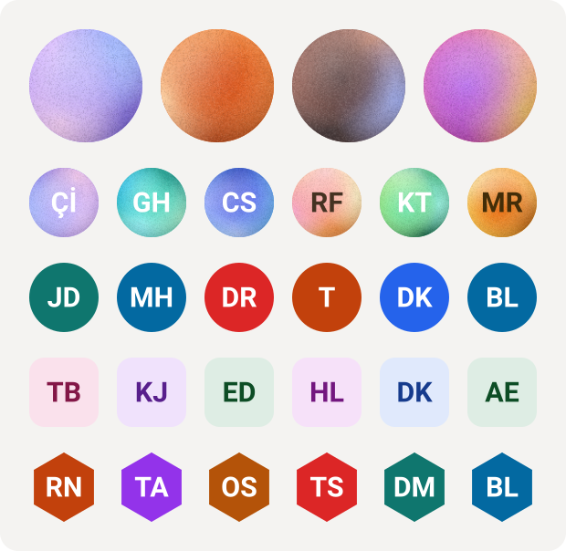

# React Native Text Avatar

[](https://www.npmjs.com/package/react-native-text-avatar)
[](https://github.com/hicay/react-native-text-avatar/actions/workflows/ci.yml)
[](./LICENSE)

Initials avatar for React Native, like the ones in Gmail. Give it a name and it
picks the initials, a background color that stays the same for that name, and a
readable text color.



- Four shapes: circle, rounded, square and hexagon
- No runtime dependencies and no native code; works with Expo and react-native-web
- Written in TypeScript
- Handles non-Latin names, emoji and locale-aware uppercasing (`i` to `İ` in Turkish)

## Installation

```sh
npm install react-native-text-avatar
```

## Usage

```tsx
import TextAvatar from 'react-native-text-avatar';

<TextAvatar>John Doe</TextAvatar>

<TextAvatar name="Ada Lovelace" size={48} shape="rounded" />

<TextAvatar shape="hexagon" backgroundColor="#ffff00">
  Grace Hopper
</TextAvatar>

<TextAvatar label="+3" backgroundColor="#e5e5ea" onPress={showEveryone} />
```

## Props

| Prop | Type | Default | Description |
| --- | --- | --- | --- |
| `children` / `name` | `string` | | Name the initials are built from. |
| `label` | `string` | | Exact text to show instead of initials, such as `+3`. |
| `size` | `number` | `60` | Width and height. |
| `shape` | `'circle' \| 'rounded' \| 'square' \| 'hexagon'` | `'circle'` | Shape of the avatar. `type` is accepted as an alias. |
| `borderRadius` | `number` | `size * 0.22` | Corner radius for the `rounded` shape. |
| `backgroundColor` | `string` | derived from the name | Background color. |
| `colors` | `string[]` | `DEFAULT_COLORS` | Palette the derived background is picked from. |
| `textColor` | `string` | dark or light | Text color. By default, whichever contrasts better with the background. |
| `maxInitials` | `number` | `2` | Maximum number of initials. |
| `uppercase` | `boolean` | `true` | Uppercase the initials. |
| `locale` | `string` | | Locale for uppercasing, such as `tr`. |
| `onPress` | `function` | | Makes the avatar pressable. |
| `style` | `ViewStyle` | | Style for the container. |
| `textStyle` | `TextStyle` | | Style for the text. |

Other `View` props, such as `testID`, are passed through.

## How initials are picked

| Name | Initials |
| --- | --- |
| `John Doe` | `JD` |
| `Technology` | `T` |
| `John Ronald Reuel Tolkien` | `JT` (`JRT` with `maxInitials={3}`) |
| `john.doe@example.com` | `JD` |
| `Çağlar İspirli` | `Çİ` |

## Helpers

The logic is exported for use outside the component, for example to color a
list row to match its avatar.

```ts
import {
  getInitials,
  getColor,
  getContrastColor,
  DEFAULT_COLORS,
} from 'react-native-text-avatar';

getInitials('John Doe'); // 'JD'
getColor('John Doe'); // '#0f766e', always the same for this name
getContrastColor('#ffff00'); // '#1c1c1e'
```

`getContrastColor` understands hex and `rgb()` colors. For named colors and
`hsl()` it returns white, so set `textColor` yourself if you use those with a
light background.

## Upgrading from 1.x

The 1.x props still work. Three defaults changed:

- The default shape is a circle. Pass `shape="square"` for the old one.
- The default background comes from the name. Pass `backgroundColor="#333"` for the old one.
- A single word gives one initial (`Technology` is `T`, not `TE`).

See the [changelog](./CHANGELOG.md) for the full list.

## License

[ISC](./LICENSE)
